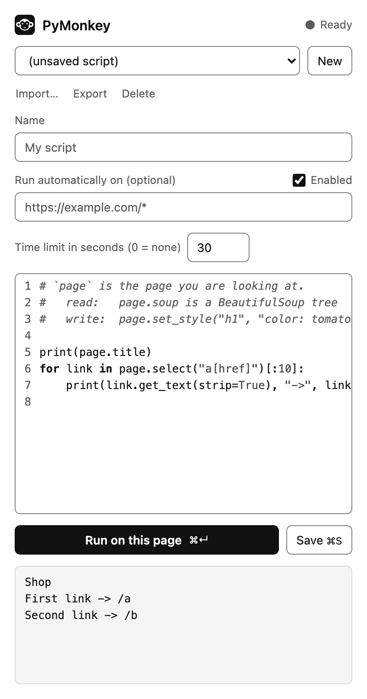
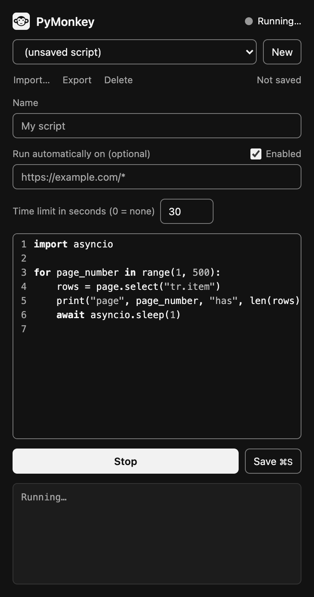

# PyMonkey

A browser extension that runs your Python scripts on the pages you visit: scrape data, change page views, automate clicks and input.

Python runs inside the browser through [Pyodide](https://pyodide.org) (CPython compiled to WebAssembly). Nothing to install besides the extension, and nothing leaves your machine.

```python
# Read the page with BeautifulSoup
for link in page.select("a[href]"):
    print(link.get_text(strip=True), "->", link["href"])

# Change the page
page.set_style("h1", "background: yellow")
page.click("button.load-more")
```

<p>
  
  
</p>

> **Status:** early skeleton. The full loop works (write a script, run it on a page, auto-run on matching URLs), but expect rough edges. Chrome/Chromium only for now.

## Quick start

Requires Chrome 137 or newer, and [Node.js](https://nodejs.org) 22+. Node is needed once, for `npm run setup`, which puts the third-party code (Pyodide and the code editor) into the extension. PyMonkey's own files are loaded by Chrome as they are, with no build step.

```bash
git clone https://github.com/Ohr-Co/PyMonkey.git
cd PyMonkey
npm install
npm run setup      # puts Pyodide, the bundled Python packages and the code editor into extension/vendor/
```

Then in Chrome:

1. Open `chrome://extensions` and turn on **Developer mode**.
2. Click **Load unpacked** and pick the `extension` folder.
3. Open any web page, click the PyMonkey toolbar icon, and press **Run on this page**. The click on the icon is also what allows PyMonkey on that page: see [Site access](#site-access).

After changing extension code, press the reload icon on the PyMonkey card in `chrome://extensions`.

## Site access

PyMonkey is installed with access to no site. Chrome shows no warning about your data when you add it, and until you say so PyMonkey cannot read or change any page. There are two ways to say so:

- **For one tab: click the PyMonkey icon in the toolbar.** This opens the panel and allows PyMonkey on the page in that tab, so **Run** works there. It lasts while the tab stays on that site; following links within the site is fine. When the tab goes to another site, or you switch to a tab where you have not clicked the icon, the panel says that PyMonkey has not been allowed there, and one more click on the icon allows it. (The icon opens the panel but does not close it. Close the panel with its own close button.)
- **For good: save a script that runs automatically.** A script with a URL pattern starts without anybody clicking anything, so its site has to be allowed for good. When you save such a script, Chrome asks whether PyMonkey may read and change your data on that site. It asks once per site. If you say no, the script is saved all the same, but it does not start by itself: the panel's list marks it "(no access)", and a line under the URL pattern says why and has an **Allow** button for when you change your mind.

Some things to know:

- Chrome gives access by site, not by page. A script for `https://example.com/shop/*` asks for all of `example.com`, and a pattern for every site, such as `*://*/*`, asks for every site.
- A tab allowed with the icon is for running by hand. A script with a pattern for that site still waits until the site has been allowed for good.
- What you have allowed is listed, and can be taken back, on PyMonkey's **Details** page at `chrome://extensions`.
- Pages that belong to the browser (`chrome://` pages, the Chrome Web Store, other extensions) cannot be allowed at all.

## Writing scripts

Every script gets a `page` object. Reading is instant and works on a local copy of the page; writing talks to the real page and returns when the page has done it. `page.store` remembers values from one run to the next, `page.fetch` gets other addresses, and `page.download` saves what you collected as a file.

| Read (works on a snapshot of the page) | |
|---|---|
| `page.url`, `page.title`, `page.html` | Basic page info |
| `page.soup` | BeautifulSoup tree of the page |
| `page.select(css)`, `page.select_one(css)` | Shortcuts for `page.soup.select(...)` |

| Write (each call changes the real page) | |
|---|---|
| `page.click(sel)` | Click the first match |
| `page.fill(sel, value)` | Type into an input |
| `page.set_text(sel, text)` | Set text of every match |
| `page.set_html(sel, html)` | Set inner HTML of every match |
| `page.set_attr(sel, name, value)` | Set an attribute on every match |
| `page.set_style(sel, css)` | Add inline CSS to every match |
| `page.insert_html(sel, html, position="beforeend")` | Insert HTML next to the first match |
| `page.remove(sel)` | Remove every match |
| `page.wait_for(sel, timeout=10)` | Wait for an element to appear |
| `page.refresh()` | Re-snapshot after the page changed |

| Remember (`page.store`, kept between runs) | |
|---|---|
| `page.store.get(key, default=None)` | The value saved under `key`, or `default` |
| `page.store.set(key, value)` | Save a value |
| `page.store.delete(key)` | Forget one key; `True` if it was there |
| `page.store.keys()` | The saved keys, in alphabetical order |
| `page.store.clear()` | Forget everything this script saved |

```python
seen = page.store.get("seen", [])
new = [a["href"] for a in page.select("a[href]") if a["href"] not in seen]
print(len(new), "links I have not seen before")
page.store.set("seen", seen + new)
```

Each saved script has its own store, which other scripts cannot read. It is kept in the browser's extension storage, so it is still there after Chrome restarts, and it is deleted together with the script. Keys are strings. Values can be anything JSON can hold (numbers, strings, booleans, `None`, lists, dicts) and come back the way `json.loads(json.dumps(value))` would return them, so a tuple comes back as a list. A script that has not been saved yet has no store: save it first. Chrome gives the extension about 10 MB for all scripts and everything they save; a value that does not fit raises `PageError` and what was saved before stays.

| Fetch (HTTP requests) | |
|---|---|
| `page.fetch(url)` | Request an address and return the response. `url` may be relative to the page |
| `response.status`, `response.ok`, `response.reason` | Status code, whether it is 200-299, and the status in words |
| `response.text`, `response.json()` | The body as a string, or parsed as JSON |
| `response.content`, `response.soup` | The body as bytes, or as a BeautifulSoup tree |
| `response.headers`, `response.url` | Response headers, and the address after redirects |
| `response.raise_for_status()` | Raise `urllib.error.HTTPError` if the status is 400 or above |

```python
for link in page.select("a.article")[:5]:
    article = page.fetch(link["href"]).soup          # follow a link on this site
    print(article.select_one("h1").get_text(strip=True))

rates = page.fetch("https://api.example.com/rates", params={"base": "EUR"}).json()
```

`page.fetch` also takes `method`, `params` (added to the address), `headers`, a body as `data` (text, bytes, or a dict of form fields) or `json`, `timeout` in seconds (30 by default), and `cookies`. A response with an error status such as 404 is returned like any other; check `response.ok`. If there is no answer at all, `page.fetch` raises `ConnectionError`, or `TimeoutError` when it took too long. Those two and `HTTPError` are all `OSError`s, so `except OSError` catches any of them.

**Requests and security.** A web page may only read answers from other sites that allow it (the browser's CORS rule). On the sites you have allowed PyMonkey on (see [Site access](#site-access)) scripts are not held to that rule: `page.fetch` can read any address there, whichever page the script runs on. That is what makes combining data from several sites possible. On every other site `page.fetch` gets what a web page would get: an answer from addresses that let any site read them, as many public APIs do, and `ConnectionError` from the rest. When a script fails that way, the panel offers to ask you for access to the site. All of this means a script can read an allowed site you are logged in to and send what it finds somewhere else, so there are two things to know:

- Cookies are what make a request count as you. `page.fetch` sends the browser's cookies only to the site the script is running on, so following links there works while you are logged in. Requests to any other site are made without cookies, as a stranger would make them, unless the script says `cookies=True`.
- That default prevents accidents; it does not fence a script in. A script is ordinary Python running inside the extension, and can reach the browser's own `fetch` through Pyodide's `js` module, cookies included, on every site you have allowed. Treat a script like any program you install: read it before you run it, above all one that somebody else wrote.

| Save (a file in your Downloads folder) | |
|---|---|
| `page.download("rows.csv", rows)` | A list of dicts becomes a CSV file: one row each, the keys as header line |
| `page.download("data.json", value)` | Anything JSON can hold becomes a JSON file |
| `page.download("notes.txt", text)` | A string or bytes is saved as it is, under any name |

```python
rows = [{"text": a.get_text(strip=True), "href": a["href"]} for a in page.select("a[href]")]
page.download("links.csv", rows)
```

The file arrives like any other download. For CSV, the columns are the keys of the dicts in the order they first appear, and a row without a key gets an empty cell; a list of lists is written without a header line. The file is UTF-8 with a byte-order mark so that Excel shows accented letters correctly (in Python, read it back with `encoding="utf-8-sig"`). Cells are written as scraped: text starting with `=` is a formula to a spreadsheet, so be as careful with a file scraped from a site you do not trust as with any other spreadsheet from a stranger. A file can be up to 30 MB, far beyond 10,000 rows. When a script saves several files in a row, Chrome may ask once whether the site may download multiple files.

Write, store, fetch and download calls need no `await`. Scripts written for earlier versions, which say `await page.click(...)`, keep working. Top-level `await` is still there for things that really are asynchronous, such as `await asyncio.sleep(1)`.

The panel's **editor** colors Python as you type, in light and dark mode. Enter after a line ending in a colon starts the next line one level deeper. Tab indents and Shift+Tab dedents, the selected lines if there are any. Because Tab indents, moving on to the next field with the keyboard takes two keys: Escape, then Tab.

What you type is not lost when the panel closes: the panel reopens with the script you were working on, changes you had not saved included. Saved scripts only change when you press **Save**.

`print()` output and tracebacks show up in the panel. While a script runs, the Run button becomes **Stop**, which ends it at once. The line at the top of the panel says what Python is doing: **Loading Python…** when the panel first opens, then **Ready**, **Running…** during a run, and after a run that did not finish **Stopped** (by you or by the time limit) or **Script failed**.

Python takes memory, about 125 MB while it is loaded, so PyMonkey does not keep it around for nothing. When no script has run for five minutes, Python is shut down and the memory goes back to your computer. The next run loads it again by itself, and starts about two seconds later for it. Opening the panel loads it too. The numbers are in [docs/memory.md](docs/memory.md).

From the keyboard, **Ctrl+Enter** runs the script and **Ctrl+S** saves it (**Cmd** instead of Ctrl on a Mac), wherever in the panel you are typing. Under the list of scripts, the panel says whether the script you are looking at is saved: "Not saved", "Unsaved changes" or "Saved". The panel follows your system's light or dark mode.

Each script has a **time limit**, 30 seconds unless you change it in the panel. A script that runs longer is stopped, so a runaway loop cannot hang around forever. Raise the limit for slow work such as a long scrape, or set it to 0 for no limit. The limit is saved with the script and also applies when it runs automatically. A stopped script's output so far is not kept.

To run a script automatically, save it with a URL pattern such as `https://example.com/*` ([match pattern syntax](https://developer.chrome.com/docs/extensions/develop/concepts/match-patterns)). The first time you save a script for a site, Chrome asks you to allow PyMonkey there (see [Site access](#site-access)). More scripts in [`examples/`](examples).

Automatic runs happen whether or not the panel is open. PyMonkey keeps each script's **last automatic run**: when it ran, on which URL, whether it succeeded, and what it printed (long output is cut to its last 20,000 characters). Select a script in the panel to see it. When an automatic run fails, the toolbar icon gets a red badge with the number of failed scripts and the script is marked "(failed)" in the panel's list. The badge goes away once you have looked at the failure in the panel, or the script is deleted.

Scripts can import the Python standard library, BeautifulSoup and a few more packages, and you can add others: see [Packages](#packages).

## Script files

Scripts live in the browser's storage. To back one up, keep it in git or pass it on, press **Export** in the panel: it saves the script you are looking at as a `.py` file. **Import…** does the reverse, for one file or several at once.

An exported file is the script's code under a header comment:

```python
# ==PyMonkey==
# @name     Price watcher
# @match    https://example.com/shop/*
# @timeout  120
# ==/PyMonkey==

for row in page.select("tr.item"):
    print(row["data-price"])
```

| Header line | Meaning | If left out |
|---|---|---|
| `# @name` | The script's name | The file's name without `.py` |
| `# @match` | The URL pattern the script runs on automatically | Blank: the script runs only when you press Run |
| `# @timeout` | The time limit in seconds, 0 for none | 30 |

The rules, for writing a header by hand:

- The header is the first thing in the file, starts with the line `# ==PyMonkey==` and ends with `# ==/PyMonkey==`. Every line in between is a comment. Lines other than the three above are ignored.
- Everything below the header is the script. To Python the header is only comments, so the file stays an ordinary Python file.
- A `.py` file without a header can be imported as well. It becomes a script named after the file that runs only when you press Run.

Importing always adds a script; it never replaces one you have, even one with the same name. Whether a script is enabled is not part of the file: **an imported script with a match pattern arrives switched off**, and starts running on its own only after you tick **Enabled** and save. That leaves time to read it first, which matters with a script somebody else wrote: a script can read the pages it runs on, sites you are logged in to included, and send what it finds elsewhere (see [Requests and security](#writing-scripts)).

## Packages

Besides the Python standard library, PyMonkey comes with:

| Package | In a script | Loaded | What it is for |
|---|---|---|---|
| beautifulsoup4 | `import bs4` | at startup | `page.soup` and `page.select()` are built on it |
| python-dateutil | `import dateutil` | on first import | Reads dates the way pages write them: `parser.parse("3 March 2024, 5pm")` |
| tzdata | `import zoneinfo` | on first import | The time zones for the standard library's `zoneinfo`, which has none in a browser without it |

```python
from dateutil import parser
from zoneinfo import ZoneInfo

posted = parser.parse("3 March 2024, 5pm").replace(tzinfo=ZoneInfo("Europe/Paris"))
print(posted.isoformat())    # 2024-03-03T17:00:00+01:00
```

**Loaded on first import** means the package costs nothing until a script uses it. Before a script starts, PyMonkey reads it for `import` lines and loads the bundled packages it finds, which takes about a tenth of a second per package and is not counted in the script's time limit. The package then stays loaded until Python is restarted. Only `import` lines are seen: a script that imports by other means, such as `importlib.import_module("dateutil")`, needs an `import dateutil` line too, and the error says so.

**Adding a package.** Any package in [Pyodide's list](https://pyodide.org/en/stable/usage/packages-in-pyodide.html) can be added:

1. In `scripts/setup.mjs`, add its name to `BUNDLED_PACKAGES`. The packages it depends on come along automatically.
2. Run `npm run setup`.
3. Reload PyMonkey at `chrome://extensions`.

A script that imports a package that is not there fails with an error that gives these same steps, or says that the package cannot be added. Packages outside Pyodide's list cannot be added: an extension may not download code while it runs, so `pip` and `micropip` are not an option.

Two packages need a word before you add them:

- **A parser for BeautifulSoup** (`lxml`, `html5lib`) must also go into `PRELOADED_PACKAGES` in `extension/worker/pyodide-worker.js`. BeautifulSoup looks for parsers once, when it is first imported, and a script that says `BeautifulSoup(html, "lxml")` has no `import lxml` line to go by.
- **`requests`** works, but inside an extension every request it makes carries your cookies for the site it goes to, on any site, and it has no setting to turn that off (the browser adds them, not `requests`). `page.fetch` sends cookies only to the site the script runs on unless you ask for more, which is why PyMonkey comes with that and not with `requests`.

### What packages cost, and why the default set is small

Measured in Chrome 145 on an Apple-silicon Mac with Pyodide 314.0.7 (Python 3.14), median of three runs. Size is the download, with the packages it depends on. Load is unpacking the package; first import is Python's `import` after that; memory is how much Python's memory grew by both. For scale: Python itself starts in about 2 seconds and is 13.5 MB of the extension.

| Package | Size | Load | First import | Memory | |
|---|---|---|---|---|---|
| beautifulsoup4 | 189 KB | 120 ms | 277 ms | 3.7 MB | **included, loaded at startup** |
| python-dateutil | 241 KB | 117 ms | 84 ms | 1.9 MB | **included** |
| tzdata | 349 KB | 181 ms | 58 ms | 2.2 MB | **included** |
| regex | 203 KB | 121 ms | 64 ms | 5.6 MB | The standard library's `re` covers most needs |
| pyyaml | 113 KB | 121 ms | 75 ms | 1.6 MB | Rarely needed on web pages, where data is JSON |
| cssselect | 19 KB | 109 ms | 30 ms | 1.8 MB | Only useful together with lxml |
| html5lib | 135 KB | 138 ms | 415 ms | 3.9 MB | Would have to be loaded at startup (see above) |
| requests | 465 KB | 133 ms | 749 ms | 7.5 MB | Cookies (see above) |
| pytz | 510 KB | 183 ms | 16 ms | 2.0 MB | `zoneinfo` replaces it |
| pillow | 1.0 MB | 176 ms | 62 ms | 4.8 MB | Images are a special interest |
| lxml | 2.1 MB | 210 ms | 117 ms | 7.1 MB | Faster parsing and XPath, but large |
| numpy | 3.0 MB | 288 ms | 452 ms | 11.5 MB | Size |
| pandas | 7.9 MB | 621 ms | 2,514 ms | 44.9 MB | Would grow the extension by more than half, and takes 2.5 seconds to import |

The decision: only BeautifulSoup is loaded at startup, because every script pays for what is loaded there. Because loading on first import makes a bundled package free until it is used, the only cost of including one is the size of the extension, so the default set holds the packages that fill a gap most scrapers run into (dates and time zones) and are small. The standard library already has `csv`, `json`, `re`, `sqlite3`, `datetime`, `statistics` and `xml`. The big packages are one line away for those who want them. Not in Pyodide's list at all, so not available: `openpyxl`, `xlsxwriter`, `tabulate`, `parsel`, `selectolax`, `dateparser`, `rapidfuzz`.

## How it works

An extension is several isolated contexts that can only pass messages to each other:

```
 web page                    extension
┌────────────────┐   ┌──────────────────┐   ┌───────────────────────────┐
│ content.js     │◄─►│ background.js    │◄─►│ offscreen document        │
│ touches the DOM│   │ message router,  │   │  └─ web worker: Pyodide   │
│ no Python      │   │ holds no state   │   │     runs your script      │
└────────────────┘   └──────────────────┘   └───────────────────────────┘
                              ▲
                     ┌────────┴─────────┐
                     │ side panel       │
                     │ script editor    │
                     └──────────────────┘
```

1. The background worker forwards your code to the offscreen document, which keeps Pyodide loaded in a web worker and runs scripts one at a time, in the order they were started.
2. When a script's turn comes, the content script snapshots the page's HTML.
3. Python reads the snapshot with BeautifulSoup. Each write, such as `page.click(...)`, travels back through the same chain to the content script, which performs it on the real page. `page.store` calls take the same road as far as the background worker, which reads and writes the extension's storage. `page.fetch` requests need no road at all: the web worker makes them itself.
4. When the script ends, its output is sent to the panel as a new message.

The manifest asks for no site, so it cannot list the content script either. Instead the background worker registers the content script with Chrome when the extension is installed, and Chrome loads it on the sites the user has allowed for good. On a tab that was allowed with the toolbar icon, the background worker puts the content script into the page when a script is first run there.

Pyodide lives in an offscreen document because Chrome shuts the background worker down after about 30 seconds of inactivity, which would throw away the loaded interpreter. It runs in a web worker so a script stuck in an infinite loop can be killed (by the Stop button or its time limit) without taking the extension down. The next run starts a fresh worker.

Python is the heavy part, and it only gives memory back by being shut down. So the offscreen document does not stay forever: after five minutes with nothing to do it closes itself, and the background worker opens a new one the next time something needs Python. A run that made Python's memory grow a lot (a very large page) gets the worker replaced as soon as it is over, and after every run Python lets go of the page it was given. [docs/memory.md](docs/memory.md) has the measurements.

For the same reason the panel never holds one request open for the length of a run: Chrome would drop the answer if it shut the background worker down in the meantime. Starting a run is answered at once, the result arrives later as its own message, and the panel checks on the run every few seconds. If a run is lost (for example the extension was reloaded while it ran), the panel says so instead of waiting.

## Project layout

```
extension/
  manifest.json
  background.js              message router, offscreen lifecycle, auto-run matching, storage, the toolbar icon
  content.js                 page snapshot, DOM primitives, saving downloads
  offscreen/                 hidden page that owns the Python worker
  worker/pyodide-worker.js   loads Pyodide, runs scripts
  python/pymonkey_runtime.py the `page` API and script runner (plain Python)
  panel/                     side panel: the form and buttons (panel.js), the code editor (editor.js)
  lib/                       URL matching, storage (scripts, last runs, page.store), run queue and run client, time limit, HTTP requests, packages, the panel's draft, scripts as .py files, how a run ended, when to shut Python down, site access
  vendor/                    Pyodide and the CodeMirror editor (created by `npm run setup`, not in git)
scripts/setup.mjs            fetches Pyodide and bundled packages, bundles the editor
scripts/codemirror-entry.mjs the parts of CodeMirror that go into the bundle
scripts/measure-memory.mjs   measures the extension's memory (`npm run measure`)
examples/                    sample scripts
docs/screenshots/            pictures of the panel, for this file
docs/memory.md               how much memory PyMonkey takes, and what is done about it
tests/                       unit tests + end-to-end test (extension-copy.mjs makes the copy of the extension it loads)
```

## Tests

```bash
npm test            # JavaScript unit tests (Node) + Python runtime (pytest, needs `pip install pytest beautifulsoup4`)
npm run test:e2e    # loads the extension in Chrome for Testing and runs real scripts
npm run measure     # not a test: prints how much memory the extension takes at each stage (see docs/memory.md)
```

The end-to-end test needs Chrome for Testing. If it is not found, install it with `npx @puppeteer/browsers install chrome@stable` and set `CHROME_PATH` to its binary.

A test cannot answer Chrome's question about [site access](#site-access), so the end-to-end test (and `npm run measure`) loads a copy of the extension that has been allowed on the test's own pages, `http://localhost` and `http://127.0.0.1`, and on nothing else. Where the question would come up, a stand-in says no.

The last check is different: it loads the extension as it is, allowed nowhere, clicks the toolbar icon and uses the real side panel. That needs a browser in which a test can click the icon. Chrome 157 is one, Chrome for Testing 145 is not, and there the check is reported as `SKIPPED`. To run it in another browser than the rest of the test:

```bash
TOOLBAR_CHROME_PATH="/Applications/Google Chrome.app/Contents/MacOS/Google Chrome" npm run test:e2e
```

## License

[AGPL-3.0](LICENSE)
